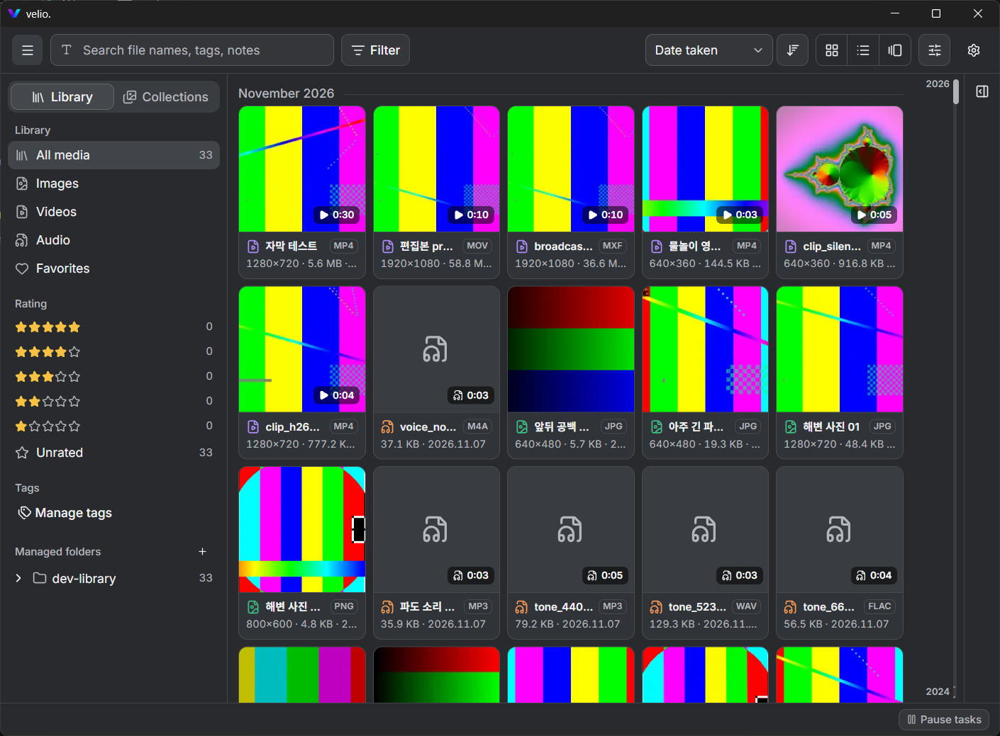

<div align="center">

# velio.

**내 PC 의 이미지·동영상·음성을 한곳에서 찾고 다시 쓰는 로컬 미디어 자산 관리(MAM) 데스크톱 앱**


**한국어** | [English](README.md)

</div>



---

## 소개

velio. 는 Windows 10/11 에 설치해 쓰는 **단일 사용자용 로컬 MAM(Media Asset Management)** 입니다.
로컬 드라이브·외장 USB·NAS 에 흩어져 있는 사용자 소유의 이미지·동영상·음성 파일을 자동으로 등록·분류·색인하고,
빠른 검색과 미리보기, 복사·내보내기로 축적된 미디어를 다시 활용할 수 있게 돕습니다.

- **원본은 그대로** — 파일을 원래 위치에 둔 채 색인합니다. 앱이 원본을 임의로 수정·이동·삭제하지 않습니다.
- **오프라인 우선** — 관리·검색은 인터넷 없이 동작합니다. 네트워크는 외부 AI 분석과 로컬 AI 모델 최초 다운로드에만 씁니다.
- **대규모 라이브러리** — 미디어 100만 개 규모에서 검색 첫 화면 3초 이내를 목표로 설계했습니다.

> [!NOTE]
> 현재 **개발 중(0.1.0)** 인 프리릴리스 단계입니다. 설치 프로그램은 코드 서명이 되어 있지 않으며(SmartScreen 경고), 기능과 데이터 형식은 바뀔 수 있습니다.

## 주요 기능

### 미디어 수집·관리
- 여러 관리 폴더(하위 폴더 포함) 등록 — 로컬 드라이브, 외장 USB, NAS
- 실시간 변경 감지 + 주기적 재스캔, 중단된 스캔 이어서 진행
- 불변 자산 ID 기반 식별 — 경로만 바뀐 파일은 기존 자산에 재연결, 내용이 바뀐 파일은 새 자산으로 등록
- 전체 내용 해시로 **완전 중복** 판정
- 드라이브 분리·NAS 연결 끊김 시 삭제하지 않고 `오프라인` / `파일 없음` 상태로 구분 — 썸네일·검색 정보·AI 결과 유지
- 촬영일·해상도·길이 등 메타데이터 추출, 썸네일·영상 미리보기 생성

### 탐색·검색
- 폴더 탐색, 갤러리(가상 스크롤), 목록 보기, 날짜별 그룹화·정렬
- 파일명·태그·메모·메타데이터 **풀텍스트 검색**(한국어 형태소 분석) 과 유형·날짜·길이·크기 등 복합 필터
- **자연어 의미 검색**과 유사 이미지·동영상 검색 (로컬 임베딩 모델)
- 사용자 정의 메타데이터 필드(짧은 글·숫자·날짜·예/아니요·선택·다중 선택) — 갤러리 필터로 사용, 원본 파일에는 쓰지 않음

### 정리·재활용
- 태그, 메모, 즐겨찾기, 별점, 가상 컬렉션(원본 이동 없이 여러 컬렉션에 소속)
- 다중 선택 일괄 복사·내보내기, 파일 클립보드 복사
- 원본 열기, Windows 탐색기에서 위치 열기

### 미리보기·재생
- 이미지 뷰어, 내장 동영상·음성 플레이어(libmpv 워커 프로세스) — 전문 코덱까지 재생
- 외부 자막, 장면전환점 검출·편집, 재생 구간 지정, 이어보기

### AI 분석
- **외부 AI**: OpenAI · Gemini · Claude 공식 API (Claude 는 사용자가 로그인한 Claude Code CLI 를 통한 구독 계정도 지원)
- 이미지 설명, 동영상 대표 프레임 기반 장면 설명, OCR, 키워드 생성 — 결과는 편집 가능하고 검색에 자동 반영
- **로컬 AI**: CLIP·multilingual-e5 임베딩(ONNX Runtime), whisper.cpp 음성 인식(STT)
- 최초 1회 동의 전에는 어떤 데이터도 외부로 보내지 않으며, 전송은 축소 이미지·대표 프레임·메타데이터/텍스트로 한정 — 원본 음성은 외부로 보내지 않고 로컬 STT 만 사용
- 자동 재시도, 실패 작업 수동 재시도, 파일별 성공/실패 이력, 사용량 기록, 일시정지/재개

### 보호·운영
- 원본 삭제·이동은 사용자가 명시적으로 요청할 때만, **비밀번호 인증** 후 실행
- 자동·수동 DB 백업(주기·보관 개수·경로 설정)과 복원, MAM 관리 데이터 초기화(원본 제외)
- 시스템 트레이 상주 감시, 승인형 자동 업데이트와 실패 시 이전 버전 자동 롤백
- 확장 **플러그인** — 샌드박스(QuickJS) 안에서 실행되는 JS 플러그인으로 메타데이터·분석·내보내기 기능 추가
- 다국어 UI — 영어·한국어 내장, 일본어·스페인어·프랑스어·독일어 언어팩 동봉

## 지원 형식

| 종류 | 형식 |
|---|---|
| 이미지 | JPG/JPEG, PNG, GIF, WebP, BMP, TIFF, HEIC/HEIF, AVIF, RAW(CR2, NEF, ARW, DNG 등) |
| 동영상 | MP4, MOV, AVI, MKV, WMV, WebM, MPEG/MPG, MTS/M2TS, MXF 등 |
| 음성 | MP3, WAV, AAC/M4A, FLAC, OGG/Opus, WMA, AIFF |

> 확장자 지원과 실제 디코딩·썸네일·재생 가능 여부는 코덱과 설치된 시스템 코덱(예: HEIF 확장)에 따라 다를 수 있습니다. 문서 파일은 관리 대상이 아닙니다.

## 기술 스택

| 영역 | 구성 |
|---|---|
| 앱 셸 | [Tauri 2](https://tauri.app/) (WebView2) |
| UI | React 19 · TypeScript · Vite · Tailwind CSS v4 · shadcn/ui · TanStack Query/Virtual · i18next |
| 코어 | Rust — 파일 식별·감시, 작업 대기열, 검색 조정 |
| 원천 DB | SQLite (WAL, rusqlite + refinery 마이그레이션) |
| 풀텍스트 | Tantivy + Lindera(ko-dic) |
| 벡터 검색 | 전수 비교(flat) · f16 · mmap |
| 미디어 | FFmpeg/FFprobe(LGPL 빌드) 사이드카, `image`, libmpv |
| AI | ONNX Runtime(`ort`), whisper.cpp 사이드카, 외부 AI 공식 API |
| 플러그인 | QuickJS-NG 워커 프로세스 |

SQLite 가 유일한 원천 데이터이며, Tantivy·벡터 인덱스는 SQLite 와 보관된 임베딩으로 언제든 다시 만들 수 있는 파생 데이터입니다.
인덱스 동기화는 Transactional Outbox + revision 방식으로 처리합니다.

## 저장소 구조

```text
velio-mam-desktop/
├─ src/                    React UI (컴포넌트, 상태, i18n, IPC 래퍼)
├─ src-tauri/              Tauri 앱 — command, 기동·업데이트 가드, 설치기 설정
├─ crates/
│  ├─ mam-db               SQLite 계층 · 마이그레이션 · 설정 · 백업
│  ├─ mam-core             자산 식별·파일 상태, 스캔·감시·작업 대기열, 사용자 데이터, 원본 보호
│  ├─ mam-search           Tantivy 풀텍스트 · Outbox 색인 워커 · 검색 조정기
│  ├─ mam-vector           벡터 인덱스 · 임베딩 저장
│  ├─ mam-media            형식 판별 · FFmpeg/FFprobe · 메타데이터 · 썸네일
│  ├─ mam-ai               모델 다운로드 · ONNX 임베딩 · STT · 외부 AI 어댑터
│  ├─ mam-player(-worker)  플레이어 호스트 + libmpv 워커 프로세스
│  └─ mam-plugin-*         플러그인 매니페스트·호스트·워커·게이트웨이·런타임
├─ examples/plugins/       샘플 플러그인과 플러그인 API 타입 정의
└─ scripts/                사이드카 받기, 워커 빌드, 라이선스 생성, 성능 측정
```

## 시작하기

### 필수 도구

- Windows 10/11 (x64), WebView2 Runtime
- [Node.js](https://nodejs.org/) 24.x, [pnpm](https://pnpm.io/) 10.x
- [Rust](https://www.rust-lang.org/) stable (`x86_64-pc-windows-msvc`)
- Visual Studio 2022 Build Tools — "C++를 사용한 데스크톱 개발"

> 첫 빌드에는 네트워크가 필요합니다(한국어 사전 약 48MB, ONNX Runtime 정적 라이브러리 약 360MB 다운로드).

### 빌드·실행

```bash
pnpm install                     # 의존성 설치
cargo build --workspace          # 플레이어·플러그인 워커 포함 전체 빌드 (최초 1회)
pnpm tauri dev                   # 개발 모드 실행
pnpm dev:temp                    # 합성 테스트 라이브러리와 함께 개발 모드 실행
```

내장 플레이어와 미디어 처리를 쓰려면 사이드카(FFmpeg, whisper.cpp, libmpv)를 받습니다. 바이너리는 저장소에 커밋하지 않습니다.

```powershell
./scripts/fetch-sidecars.ps1     # 다운로드 + SHA-256 검증 + 배치
```

### 테스트

```bash
pnpm typecheck                   # TypeScript 검사
pnpm test                        # 프론트엔드 테스트 (vitest)
cargo test --workspace           # Rust 단위·통합 테스트
cargo clippy --workspace --all-targets -- -D warnings
```

### 설치 프로그램 빌드

```bash
pnpm tauri build --config src-tauri/tauri.sidecars.conf.json
```

NSIS 설치 프로그램을 만들며, 업데이트 서명 키가 필요합니다. 데이터 디렉터리 구조, 마이그레이션 작성법, 릴리스·업데이트 절차, 기능별 개발 메모는 **[DEVELOPER.md](DEVELOPER.md)** 를 참고하세요.

## 데이터 저장 위치

관리 데이터(DB·검색 인덱스·썸네일 캐시·AI 모델·백업·로그)는 기본적으로 `%LOCALAPPDATA%\MAMDesktop\MAMData` 에 저장되며, 설정에서 위치를 바꿀 수 있습니다.
원본 미디어 폴더에는 아무것도 쓰지 않으며, 앱을 제거해도 관리 데이터는 남습니다.

## 플러그인

플러그인은 `plugin.json` 매니페스트와 JavaScript 파일 하나로 구성되며, 네트워크·파일·프로세스 접근이 없는 별도 워커 프로세스에서 실행됩니다.
선언하고 사용자가 허용한 권한(메타데이터 읽기, 썸네일 읽기, KV 저장소, 태그 추가, 내보내기)만 쓸 수 있고, 원본 미디어를 수정하는 API 는 없습니다.

- 샘플: [`examples/plugins/exif-summary/`](examples/plugins/exif-summary/)
- 타입 정의: [`examples/plugins/plugin-api.d.ts`](examples/plugins/plugin-api.d.ts)
- 설치: 앱 **설정 > 플러그인 > 폴더에서 설치…**

## 라이선스

이 프로젝트는 [Apache License 2.0](LICENSE) 으로 배포됩니다.

설치 프로그램에 동봉되는 서드파티 프로그램(FFmpeg, whisper.cpp, libmpv)과 라이브러리·AI 모델의 고지는 [THIRD_PARTY_NOTICES.md](THIRD_PARTY_NOTICES.md) 와 [THIRD_PARTY_LICENSES.md](THIRD_PARTY_LICENSES.md) 에 있습니다.
동봉된 FFmpeg 빌드 등 일부 구성요소는 Apache-2.0 이 아닌 (L)GPL 등 자체 라이선스를 따릅니다.
