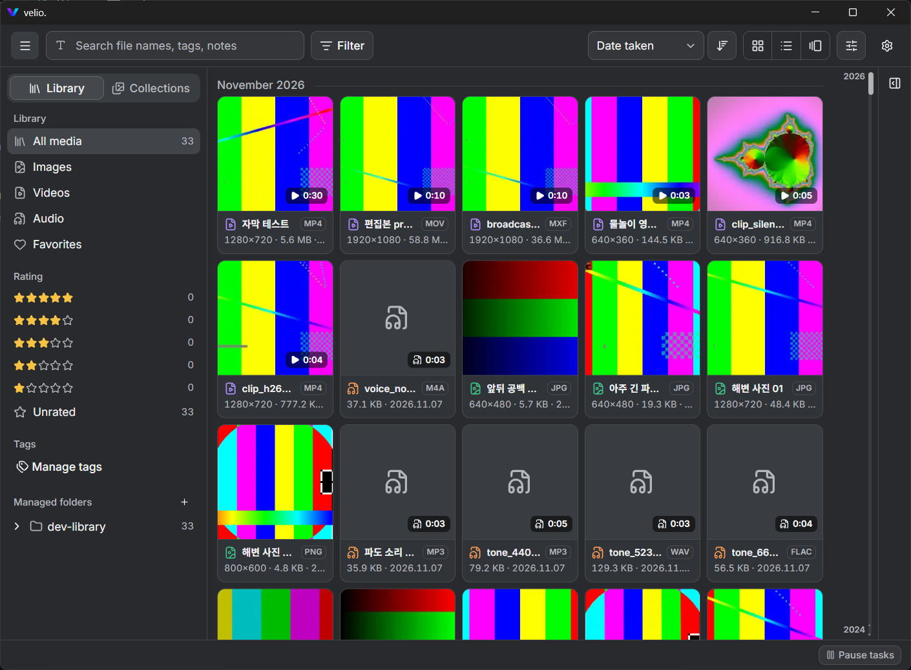

<div align="center">

# velio.

**A local media asset management (MAM) desktop app for finding and reusing the images, videos and audio on your PC**


[한국어](README.ko.md) | **English**

</div>



---

## About

velio. is a **single-user local MAM (Media Asset Management)** application installed on Windows 10/11.
It automatically registers, organizes and indexes the images, videos and audio files you own, scattered across local drives,
external USB drives and NAS shares, and helps you reuse your media library through fast search, previews, copying and export.

- **Originals stay untouched**: files are indexed where they are. The app never modifies, moves or deletes originals on its own.
- **Offline first**: library management and search work without an internet connection. The network is only used for external AI analysis and the first download of local AI models.
- **Built for large libraries**: designed to show the first page of search results within 3 seconds for a library of 1 million media files.

> [!NOTE]
> This project is **under active development (0.1.0)** and has not been released yet. The installer is not code-signed (expect a SmartScreen warning), and features and data formats may change.

## Features

### Media ingestion and management
- Register multiple managed folders (including subfolders) on local drives, external USB drives and NAS shares
- Real-time change detection plus periodic rescans; interrupted scans resume where they left off
- Identity based on immutable asset IDs: a file that only changed path is relinked to its existing asset, and a file whose content changed becomes a new asset
- **Exact duplicates** are detected by full-content hash
- Disconnected drives or NAS shares are not treated as deletions. Assets are marked `offline` or `missing`, and their thumbnails, search data and AI results are kept
- Metadata extraction (capture date, resolution, duration, etc.), thumbnails and video previews

### Browsing and search
- Folder browser, virtualized gallery, list view, grouping and sorting by date
- **Full-text search** over file names, tags, notes and metadata (with Korean morphological analysis), combined with filters for type, date, duration, size and more
- **Natural-language semantic search** and similar image/video search (local embedding models)
- Custom metadata fields (short text, number, date, yes/no, single and multiple choice) usable as gallery filters, never written to the original files

### Organizing and reuse
- Tags, notes, favorites, star ratings and virtual collections (an asset can belong to several collections without moving files)
- Bulk copy and export of multiple selected items, copy files to the clipboard
- Open the original, or reveal its location in Windows Explorer

### Preview and playback
- Image viewer and built-in video/audio player (libmpv worker process) that handles professional codecs
- External subtitles, scene-cut detection and editing, play ranges and resume playback

### AI analysis
- **External AI**: official OpenAI, Gemini and Claude APIs (Claude also works with a subscription account through a Claude Code CLI the user has installed and signed in to)
- Image descriptions, scene descriptions from representative video frames, OCR and keyword generation. Results can be edited and are automatically reflected in search
- **Local AI**: CLIP and multilingual-e5 embeddings (ONNX Runtime) and whisper.cpp speech-to-text (STT)
- Nothing is sent externally until the user gives consent once. Transfers are limited to downscaled images, representative frames and metadata/text. Original audio is never sent out; only local STT is used
- Automatic retries, manual retry of failed jobs, per-file success/failure history, usage logging, pause and resume

### Protection and operations
- Originals are deleted or moved only on an explicit user request, after **password authentication**
- Automatic and manual DB backups (configurable interval, retention count and location), restore, and a reset of MAM-managed data (originals excluded)
- Folder watching while running in the system tray; approval-based automatic updates with automatic rollback to the previous version on failure
- Extensible **plugins**: JavaScript plugins running in a QuickJS sandbox add metadata, analysis and export features
- Multilingual UI: English and Korean built in; Japanese, Spanish, French and German language packs included

## Supported formats

| Type | Formats |
|---|---|
| Image | JPG/JPEG, PNG, GIF, WebP, BMP, TIFF, HEIC/HEIF, AVIF, RAW (CR2, NEF, ARW, DNG, etc.) |
| Video | MP4, MOV, AVI, MKV, WMV, WebM, MPEG/MPG, MTS/M2TS, MXF, etc. |
| Audio | MP3, WAV, AAC/M4A, FLAC, OGG/Opus, WMA, AIFF |

> Supported extensions do not guarantee decoding, thumbnails or playback. These depend on the codec and installed system codecs (e.g. the HEIF extension). Document files are not managed.

## Tech stack

| Area | Components |
|---|---|
| App shell | [Tauri 2](https://tauri.app/) (WebView2) |
| UI | React 19 · TypeScript · Vite · Tailwind CSS v4 · shadcn/ui · TanStack Query/Virtual · i18next |
| Core | Rust: file identity and watching, job queue, search coordination |
| Source-of-truth DB | SQLite (WAL, rusqlite + refinery migrations) |
| Full-text | Tantivy + Lindera (ko-dic) |
| Vector search | Exhaustive (flat) scan · f16 · mmap |
| Media | FFmpeg/FFprobe (LGPL build) sidecars, `image`, libmpv |
| AI | ONNX Runtime (`ort`), whisper.cpp sidecar, official external AI APIs |
| Plugins | QuickJS-NG worker process |

SQLite is the only source of truth. The Tantivy and vector indexes are derived data that can always be rebuilt from SQLite and the stored embeddings.
Index synchronization uses a Transactional Outbox with revisions.

## Repository layout

```text
velio-mam-desktop/
├─ src/                    React UI (components, state, i18n, IPC wrappers)
├─ src-tauri/              Tauri app: commands, startup and update guard, installer config
├─ crates/
│  ├─ mam-db               SQLite layer · migrations · settings · backup
│  ├─ mam-core             asset identity and file state, scan/watch/job queue, user data, original protection
│  ├─ mam-search           Tantivy full-text · Outbox index worker · search coordinator
│  ├─ mam-vector           vector index · embedding store
│  ├─ mam-media            format detection · FFmpeg/FFprobe · metadata · thumbnails
│  ├─ mam-ai               model download · ONNX embeddings · STT · external AI adapters
│  ├─ mam-player(-worker)  player host + libmpv worker process
│  └─ mam-plugin-*         plugin manifest, host, worker, gateway and runtime
├─ examples/plugins/       sample plugin and plugin API type definitions
└─ scripts/                sidecar download, worker builds, license generation, performance measurement
```

## Getting started

### Prerequisites

- Windows 10/11 (x64), WebView2 Runtime
- [Node.js](https://nodejs.org/) 24.x, [pnpm](https://pnpm.io/) 10.x
- [Rust](https://www.rust-lang.org/) stable (`x86_64-pc-windows-msvc`)
- Visual Studio 2022 Build Tools with "Desktop development with C++"

> The first build needs network access (it downloads a Korean dictionary of about 48 MB and the ONNX Runtime static library of about 360 MB).

### Build and run

```bash
pnpm install                     # install dependencies
cargo build --workspace          # full build including player and plugin workers (once)
pnpm tauri dev                   # run in development mode
pnpm dev:temp                    # run in development mode with a synthetic test library
```

To use the built-in player and media processing, fetch the sidecars (FFmpeg, whisper.cpp, libmpv). Binaries are not committed to the repository.

```powershell
./scripts/fetch-sidecars.ps1     # download + SHA-256 verification + placement
```

### Tests

```bash
pnpm typecheck                   # TypeScript check
pnpm test                        # frontend tests (vitest)
cargo test --workspace           # Rust unit and integration tests
cargo clippy --workspace --all-targets -- -D warnings
```

### Building the installer

```bash
pnpm tauri build --config src-tauri/tauri.sidecars.conf.json
```

This builds an NSIS installer and requires an updater signing key. See **[DEVELOPER.md](DEVELOPER.md)** (Korean) for the data directory layout, writing migrations, the release and update process, and per-feature development notes.

## Data location

Managed data (DB, search indexes, thumbnail cache, AI models, backups, logs) is stored in `%LOCALAPPDATA%\MAMDesktop\MAMData` by default, and the location can be changed in Settings.
Nothing is written to your original media folders, and managed data is kept when the app is uninstalled.

## Plugins

A plugin consists of a `plugin.json` manifest and a single JavaScript file, and runs in a separate worker process with no network, file or process access.
It can only use the permissions it declares and the user grants (read metadata, read thumbnails, KV storage, add tags, export). No API can modify original media.

- Sample: [`examples/plugins/exif-summary/`](examples/plugins/exif-summary/)
- Type definitions: [`examples/plugins/plugin-api.d.ts`](examples/plugins/plugin-api.d.ts)
- Install: in the app, **Settings > Plugins > Install from folder…**

## License

This project is distributed under the [GNU General Public License v3.0 only](LICENSE) (GPL-3.0-only), with an additional permission for plugins: plugins that interact with the app only through the plugin API may use any license (see [LICENSE](LICENSE)).

Notices for the third-party programs bundled with the installer (FFmpeg, whisper.cpp, libmpv), libraries and AI models are in [THIRD_PARTY_NOTICES.md](THIRD_PARTY_NOTICES.md) and [THIRD_PARTY_LICENSES.md](THIRD_PARTY_LICENSES.md).
Some components, such as the bundled FFmpeg build, are under their own licenses, such as the LGPL; see the notices above.
